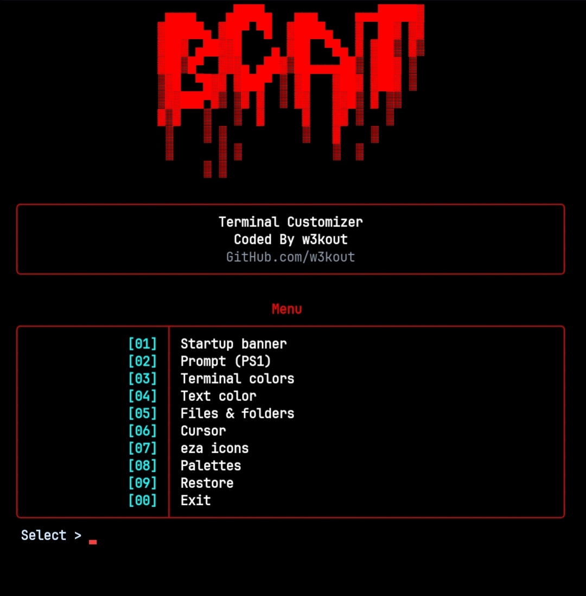

<div align="center">

# 🐱 BCAT

### Premium Terminal Customizer


**An interactive terminal customization toolkit built for Termux.**
Transform the default terminal into a personalized experience with a collection of customization tools and visual enhancements.

</div>

---

## 📸 Preview

<p align="center">
  
</p>

---

## ⚡ Installation

Run the following commands in Termux (use the copy icon at the top-right of the box to copy everything at once):

```bash
pkg update -y && pkg upgrade -y
pkg install git -y
git clone https://github.com/w3kout/bcat.git bcat
cd bcat
bash install
```

---

## ✨ Features

| Feature | Description |
|:--------|:------------|
| 🎨 **Startup Banners** | Custom ASCII banners with colors and animation effects |
| 💻 **Shell Prompts** | 25 different Bash, Zsh, and Fish prompt designs |
| 🖥️ **Terminal Colors** | Customize background, text, and cursor colors |
| 🔤 **Text Colors** | Personalize terminal text colors |
| 📁 **File & Folder Colors** | Customize file and directory colors |
| ▮ **Cursor Customization** | Change cursor shape and color |
| 🧩 **eza Icons** | Install and configure eza with terminal icons |
| ♻️ **Restore** | Restore default terminal configurations |

---

## 📋 Project Info

| | |
|:--|:--|
| **Name** | BCAT |
| **Version** | v1.0 |
| **Platform** | Termux (Android) |
| **Supported Shells** | Bash, Zsh, Fish |
| **Developer** | W3kout |

---

## 📝 NOTE

> **If you want to add your custom banner:**
>
> 1. Open the `.banner/` folder in the project.
> 2. Paste your ASCII logo in a `.txt` file (any name you like).
> 3. Run `bcat` and you will see the banner added to the startup logo.

---

<p align="center">
  <b>BCAT — Customize Your Terminal.</b><br>
  Developed by <b>W3kout</b>
</p>
